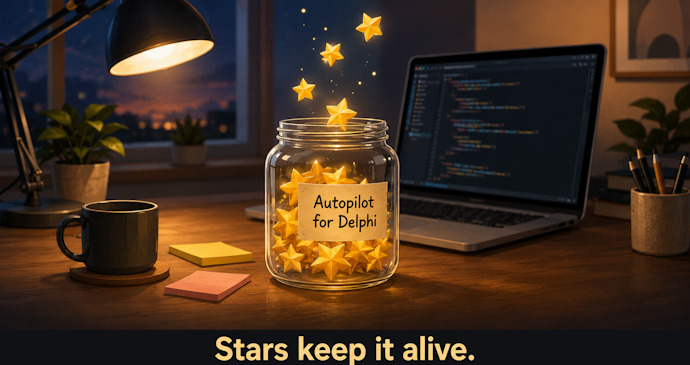

# Autopilot for Delphi

**There is a big gap between Claude and your Delphi app. Autopilot closes it.**

An AI assistant can write your Delphi code and compile it, but then it stops: it cannot run the program and click its buttons.
Autopilot for Delphi hands the controls of your running VCL or FMX app to the AI.
The AI can click all controls, type text into edit boxes, read the labels, set and read any property, and take screenshots - the same loop a human operator runs, with no human at the keyboard.
It works in the background and never moves the mouse, so you can keep working while the AI tests.

The full description lives on the website: **[GabrielMoraru.com/autopilot](https://gabrielmoraru.com/my-delphi-code/autopilot-for-delphi/)**.
When this file and the website disagree, the website is right.

## How to install it

Clone this repository to a folder, then ask your AI assistant to install the MCP server from that folder.
The AI builds it, registers it and tells you when to restart it.
Step by step, with the exact prompt: **[How to install it](https://gabrielmoraru.com/my-delphi-code/autopilot-for-delphi/)**.

### Install steps for the AI

The repository holds the source of the MCP server, not the EXE, so the first step builds it.
`<repo>` below is the folder the user named.

1. Find Delphi: the newest key under `HKEY_CURRENT_USER\Software\Embarcadero\BDS\` holds the value `RootDir`, the Delphi folder.
2. Build the MCP server for Win32, Release, in one `cmd` call:
   `call "<RootDir>bin\rsvars.bat" && msbuild "<repo>\Source\McpServer\Autopilot.Mcp.dproj" /t:Build /p:Config=Release /p:Platform=Win32`
   (the switch is `/p:Config=`; MSBuild ignores `/p:Configuration=` for a Delphi project).
   If the build answers "This version of the product does not support command line compiling" (Delphi Community Edition), or Delphi has no `dcc32.exe` in its `bin` folder, stop and ask the user, in one sentence, to open `<repo>\Source\McpServer\Autopilot.Mcp.dproj` in Delphi, select Release and Win32, click Build, then tell you "done".
3. Check that `<repo>\Source\McpServer\Win32_Release\Autopilot.Mcp.exe` exists.
4. Register it (Claude Code): `claude mcp add autopilot -- "<repo>\Source\McpServer\Win32_Release\Autopilot.Mcp.exe"`
5. Tell the user to restart the AI session.

## How to use it

**Demo app:** open `DemoVCL\Autopilot.Demo.dproj` and run it.
Then ask your AI assistant: *"List the controls of Autopilot.Demo app, then click btnIncrement five times and read lblCounter and confirm it shows the correct answer."*

**Your own app:** ask the AI to wire Autopilot into your project, then talk to it about your app in plain words:

> *"Start my app, type 'Gabriel' in the name field, press Save, and tell me what the status label says."*

**Repeatable GUI tests, with no AI:** your DUnitX tests start the app, click, type, read the labels and check the result with `Assert`.
No AI and no tokens, so the tests run on every build.
See [Automated GUI testing in Delphi](https://gabrielmoraru.com/my-delphi-code/automated-gui-testing-delphi/).

## Supported platforms

- Delphi: Rio, Alexandria, Athens and Florence. Users report that it works on Delphi 10.2 too.
- Platforms: Win32, Win64 (VCL and FMX), Android (FMX). Mac to be added soon.
- An AI assistant that speaks MCP: Claude Code, Kai, Claude Desktop, Cursor, Cline.
- No third-party dependencies.

## License

[LICENSE](LICENSE)

## Related topics

* [How does it compare with Embarcadero Kai?](https://gabrielmoraru.com/my-delphi-code/autopilot-for-delphi-details/#kai)
* [How it works](https://gabrielmoraru.com/my-delphi-code/autopilot-for-delphi-details/#how-it-works)
* [The tools the AI calls](https://gabrielmoraru.com/my-delphi-code/autopilot-for-delphi-details/#tools)
* [Native OS dialogs](https://gabrielmoraru.com/my-delphi-code/autopilot-for-delphi-details/#native-dialogs)
* [What it deliberately doesn't do](https://gabrielmoraru.com/my-delphi-code/autopilot-for-delphi-details/#limits)
* [Found a bug?](https://gabrielmoraru.com/my-delphi-code/autopilot-for-delphi-details/#found-a-bug)
* [Automated GUI testing in Delphi](https://gabrielmoraru.com/my-delphi-code/automated-gui-testing-delphi/)
* [What's new in each version](https://gabrielmoraru.com/my-delphi-code/autopilot-for-delphi-whats-new/)
* [Security and privacy](https://gabrielmoraru.com/my-delphi-code/autopilot-for-delphi-security-and-privacy/)

Questions, or something broke? [Write to me](https://gabrielmoraru.com/about-me/).
If Autopilot is useful to you, give it a star on GitHub.

